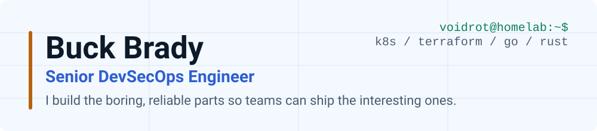
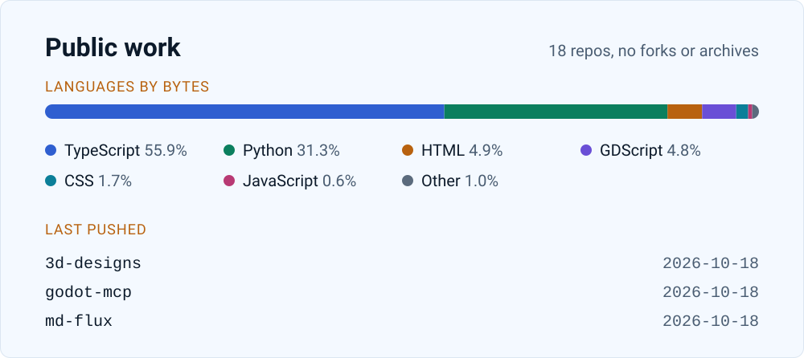

<picture>
  <source media="(prefers-color-scheme: dark)" srcset="assets/header-dark.svg">
  <source media="(prefers-color-scheme: light)" srcset="assets/header-light.svg">
  
</picture>

```console
$ whoami
buck (a.k.a. voidrot)

$ cat role
Senior DevSecOps Engineer, 12+ years, remote from Utah

$ cat focus
platforms, delivery pipelines, security that doesn't slow people down

$ cat interests
homelab, 3D printing, ESP32/IoT, EVE Online
```

I like infrastructure that nobody has to think about. Most of what's here started as an itch at home or at work and got turned into something reusable. If a homelab rack and a tangle of YAML make you happy, we'll get along.

## Stack, as layers

| Layer | What I reach for |
| --- | --- |
| Cloud | AWS, GCP |
| Orchestration | Kubernetes (EKS, GKE), Docker |
| Infrastructure as code | Terraform, Pulumi, Ansible, Nix |
| Delivery | GitHub Actions, GitOps with Flux and Argo |
| Observability | Prometheus |
| Languages | Go, Python, TypeScript, Rust |
| Frameworks | Django |

## Featured work

Public repos only. The bigger stuff is behind someone else's login.

**Platform and developer experience**
- [composable](https://github.com/voidrot/composable): a library of Docker Compose fragments and a CLI to stitch them together, so local setups stop drifting.
- [md-flux](https://github.com/voidrot/md-flux): syncs markdown docs to Confluence.
- [gchat-action](https://github.com/voidrot/gchat-action): a GitHub Action that posts to Google Chat.
- [dag-sync](https://github.com/voidrot/dag-sync): pulls Airflow DAGs from S3 to the local filesystem.
- [charts](https://github.com/voidrot/charts) and [containers](https://github.com/voidrot/containers): Helm charts and container images I maintain.

**AI and agents**
- [waygate](https://github.com/voidrot/waygate): a living knowledge workspace where LLM agents ingest, synthesize and curate technical notes.
- [promptbench](https://github.com/voidrot/promptbench): a CLI for testing and refining agent prompts and tool-calling skills.
- [openai-featherless-compatible](https://github.com/voidrot/openai-featherless-compatible): an AI SDK wrapper that turns tool calls emitted as plain text into real function calls.
- [godot-mcp](https://github.com/voidrot/godot-mcp) and [kan-mcp](https://github.com/voidrot/kan-mcp): MCP servers for Godot and Kan.bn.
- [agents](https://github.com/voidrot/agents): my agent definitions.

**Homelab and network**
- [watchdeck](https://github.com/rackrot/watchdeck): a "Stream Deck" for the homelab (under the [rackrot](https://github.com/rackrot) org).
- [opnsense-mcp](https://github.com/voidrot/opnsense-mcp) and [gopnsene](https://github.com/voidrot/gopnsene): an MCP server and a Go API client for OPNsense.
- [dns-blocklists](https://github.com/voidrot/dns-blocklists): DNS blocklists for the network.

**Off the clock**
- [3d-designs](https://github.com/voidrot/3d-designs): things I've designed for the printer.

## Latest writing

<!-- BLOG:START -->
- [Composable: Orchestrating Docker Compose Without the Boilerplate](https://buckbrady.com/blog/composable-launch/) <sub>Apr 18, 2026</sub>
- [From Tooling Fatigue to 'Mise en Place': Consolidating My Dev Stack](https://buckbrady.com/blog/from-tooling-fatigue-to-mise/) <sub>Feb 26, 2026</sub>
<!-- BLOG:END -->

## Activity

<picture>
  <source media="(prefers-color-scheme: dark)" srcset="assets/activity-dark.svg">
  <source media="(prefers-color-scheme: light)" srcset="assets/activity-light.svg">
  
</picture>

Generated daily from public repos by a [small script](scripts/update-readme.mjs) in this repo.

---

[buckbrady.com](https://buckbrady.com) | [Resume](https://buckbrady.com/resume/) | [LinkedIn](https://www.linkedin.com/in/buckbrady) | [RSS](https://buckbrady.com/rss.xml)
